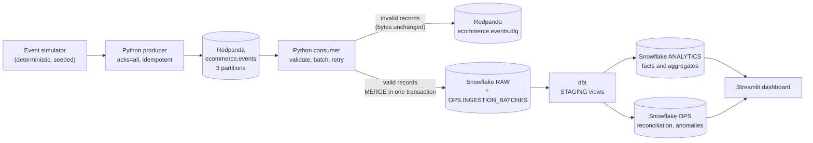

# StreamForge

An event-driven e-commerce data engineering pipeline: simulated order events stream through **Redpanda (Kafka API)**, are validated and loaded into **Snowflake** by a Python consumer, transformed with **dbt**, and presented in a **Streamlit** dashboard.

> **Status:** MVP complete (milestones M0–M8) and tested locally. It runs on a developer machine with a single-node broker and an XS warehouse; it is a portfolio project, not a deployed production service. Throughput has not been benchmarked yet. See [Limitations](#limitations).

## The problem

E-commerce systems emit a continuous stream of events (orders, payments, cancellations, shipments) that arrive **out of order, duplicated, or malformed**. Turning them into trustworthy numbers needs a pipeline that:

- does not lose events when a broker, database or process fails mid-batch;
- quarantines bad records without blocking good ones;
- removes duplicates caused by retries and replays;
- derives each order's current state from event *sequence*, not arrival order;
- never mixes currencies in revenue figures;
- can prove, batch by batch, that every consumed record is accounted for.

StreamForge implements that pipeline end to end. Its failure behaviour is covered by unit and failure-injection tests; the cases it does *not* fully handle are listed under [Limitations](#limitations).

## Architecture



The consumer's commit protocol (sequence diagram), component details and implementation status are in [`docs/architecture.md`](docs/architecture.md).

## Technology stack

| Layer | Technology |
|---|---|
| Language | Python 3.11 (pydantic v2 event contract) |
| Streaming | Redpanda v26.2.6 via Docker Compose; `confluent-kafka` client |
| Warehouse | Snowflake (key-pair auth, least-privilege role, XS warehouse, resource monitor) |
| Transformation | dbt Core 1.12.6 + dbt-snowflake 1.12.5 (separate virtualenv, no external packages) |
| Dashboard | Streamlit + Altair |
| Quality | pytest, ruff, dbt data tests and dbt unit tests |

## Key features

**Event contract and simulator**
- Four event types (`order_created`, `payment_processed`, `order_cancelled`, `shipment_dispatched`) with `event_id`, UTC `event_timestamp`, per-order `sequence_number` and `schema_version`; the contract is enforced in code and kept in sync with [`docs/event-schema.md`](docs/event-schema.md) by a test.
- Deterministic simulator: the same seed and start time give byte-identical output.
- Optional injection of 12 kinds of invalid records (malformed JSON, missing `order_id`, naive timestamps, negative amounts, total mismatches, …) as *extra* records, so produced = valid + invalid.

**Producer**
- Publishes values byte-for-byte, keyed by `order_id`; `acks=all`, idempotence on; success is counted only on delivery confirmation; non-zero exit code on any unconfirmed message.

**Consumer (Kafka → Snowflake RAW)**
- Batches are classified; invalid records go to a dead-letter topic **unchanged**, with failure-reason headers.
- Valid records are `MERGE`d into one RAW table per event type on (topic, partition, offset), with an audit row per batch, in one transaction, so redelivery inserts nothing twice.
- Offsets are committed only after the DLQ delivery is confirmed **and** the Snowflake transaction is committed, and only after every consumed record is accounted for.
- A DLQ de-duplication index reads the whole retained DLQ at startup and refreshes before every publish, so replays, restarts and partition hand-offs do not re-dead-letter records that are still in the DLQ. Two exceptions (a concurrent-publish race and DLQ retention) are listed under [Limitations](#limitations).
- Bounded retries with backoff; on persistent failure the consumer stops without committing the failed batch, which is redelivered on restart.

**Snowflake and dbt**
- Idempotent setup (`CREATE … IF NOT EXISTS` only, never `OR REPLACE` or `DROP`, enforced by a unit test); the role's grants are checked against an expected list.
- 13 dbt models: STAGING views deduplicate by `event_id`; incremental `fct_orders` derives status from `sequence_number`, recomputing touched orders from full history; daily aggregates are per currency; OPS views reconcile RAW against the consumer's audit and flag anomalies (sequence gaps, shipped without payment, conflicting duplicates, …).
- dbt data tests, 7 singular tests and 6 dbt unit tests with mocked inputs (out-of-order arrival, late events, duplicates, currency separation).

**Dashboard**
- Five tabs: Executive Overview, Orders, Products, Geography and Pipeline Health (batches, reconciliation, dead-letter rate, anomalies).
- Read-only queries against ANALYTICS and OPS only, as `STREAMFORGE_ROLE`; money is always shown per currency; errors are scrubbed before display.

**Security**
- Credentials only in `.env` (gitignored) or the environment; the private key lives outside the repository.
- Secrets are redacted from errors and exception chains are suppressed; admin roles are refused by the consumer, dbt runner and dashboard.

## Pipeline workflow

1. **Simulate and publish** events to `ecommerce.events` (3 partitions).
2. **Consume** in batches: validate → dead-letter invalid records → `MERGE` valid ones into Snowflake RAW → commit offsets.
3. **Transform** with dbt: RAW → STAGING (typed, deduplicated) → ANALYTICS (facts, daily aggregates) and OPS (reconciliation, anomalies).
4. **Explore** the results in the Streamlit dashboard.

Each step is started by hand today; scheduling is on the roadmap.

## Getting started

The full, ordered walkthrough is in **[`docs/getting-started.md`](docs/getting-started.md)**: Docker → Redpanda topics → Snowflake setup → consumer offset initialisation → producer → consumer → dbt → dashboard. In short (Windows paths; run from the repository root):

```
py -3.11 -m venv .venv
.venv/Scripts/python.exe -m pip install -e ".[dev]"
cp .env.example .env                                         # then fill in Snowflake settings
docker compose -f infra/docker-compose.yml up -d --wait      # Redpanda + topics
.venv/Scripts/python.exe -m streamforge.admin.snowflake_setup apply
docker exec streamforge-redpanda rpk group seek streamforge-consumer --to start --topics ecommerce.events --allow-new-topics
.venv/Scripts/python.exe -m streamforge.producer --orders 100 --seed 42 --start-time 2026-11-23T10:00:00Z --invalid-rate 0.05
.venv/Scripts/python.exe -m streamforge.consumer --stop-when-idle 30
.venv-dbt/Scripts/python.exe dbt/run_dbt.py build             # after creating .venv-dbt (see the guide)
.venv/Scripts/python.exe -m streamlit run src/streamforge/dashboard/app.py
```

Without a Snowflake account you can still run the simulator, the producer, Redpanda and all unit and Redpanda integration tests.

## Testing

| Suite | Command | Needs | Result (last local run, 2026-11-26) |
|---|---|---|---|
| Unit | `.venv/Scripts/python.exe -m pytest` | Nothing | **420 passed** |
| Redpanda integration | `.venv/Scripts/python.exe -m pytest -m "integration and not snowflake"` | Local Redpanda | **20 passed** in 4 min 22 s |
| Live Snowflake | `.venv/Scripts/python.exe -m pytest -m snowflake` | Snowflake credentials | 8 tests; run separately (some use the warehouse) |
| dbt | `.venv-dbt/Scripts/python.exe dbt/run_dbt.py build` | Snowflake | Data tests, singular tests, dbt unit tests |
| Lint | `.venv/Scripts/python.exe -m ruff check src tests dbt/run_dbt.py` | Nothing | Clean |

The integration suite includes **11 failure-injection scenarios** on temporary topics (Snowflake faked): broker unavailable at startup, DLQ delivery failure, Snowflake connection and transaction failures, a process killed after the RAW commit and after the DLQ delivery, duplicate delivery, graceful stop with uncommitted messages, replay of committed messages, per-partition offsets after a crash, and two consumers in one group. In each scenario the test checks that no record is lost, RAW and the DLQ hold no duplicates, and the committed offsets reach the partition ends. See [`docs/reliability.md`](docs/reliability.md).

These results come from local runs; there is no CI yet.

## Dashboard

| Tab | Shows |
|---|---|
| Executive Overview | Gross order value, paid value, net revenue, orders, payment success and cancellation rates for one currency; per-currency summary |
| Orders | Orders by status, payment status, orders and revenue per day |
| Products | Top products by units, net revenue per product, SKU table |
| Geography | Orders and revenue by shipping country |
| Pipeline Health | Batches, rows loaded, duplicates skipped, reconciliation, dead-letter rate, data-quality anomalies |

Details, metric definitions and costs: [`docs/dashboard.md`](docs/dashboard.md).

## Engineering decisions

- **At-least-once delivery with idempotent sinks**, rather than claiming exactly-once: RAW `MERGE` on Kafka coordinates and a DLQ index keyed on coordinates *plus* a SHA-256 of the message, so a reused offset with different content is never silently skipped.
- **Commit last**: offsets are committed synchronously, per partition, only after both sinks confirm. A crash before the commit leads to redelivery of the uncommitted batch, which the idempotent sinks absorb; the tested crash points lose no records.
- **Message bytes are never re-serialised**: the DLQ holds the original key and value; RAW keeps `RAW_VALUE`.
- **Explicit starting offsets**: the consumer refuses to guess (`--offset-reset error`), protecting historical messages.
- **Status from `sequence_number`, not arrival order**, and dates derived only after converting timestamps to UTC.
- **Least privilege and cost control**: one dedicated role and warehouse, secondary roles disabled on every connection, a 5-credit monthly resource monitor, 60-second auto-suspend.
- **dbt in its own virtualenv**, pinned to stable releases, to avoid dependency conflicts with the application.

## Limitations

- **Not exactly-once end to end; the DLQ can contain duplicates.** Two consumers in one group can both dead-letter the same record if one is evicted from the group while still running (frozen, cut off from the coordinator, or stuck in retries against a degraded broker for longer than the 300 s poll interval). The result is a duplicate DLQ entry; the record itself is still dead-lettered. A unit test reproduces this. Kafka transactions would close it but are not implemented.
- **DLQ retention.** If a DLQ entry expires (or the DLQ's retention is shortened) while its source message is still retained, replaying that message dead-letters it again: another duplicate DLQ entry.
- **Not benchmarked.** The 100 events/s figure in the architecture doc is a design target, not a measurement.
- **Manual orchestration.** The consumer, dbt and dashboard refresh are run by hand; dashboard data is as fresh as the last dbt build (plus a 10-minute cache).
- **Single local broker** (one replica), no high availability. Several consumers in one group are supported and tested locally, but nothing is deployed or supervised.
- **Audit coverage:** batches containing only invalid records get no row in `OPS.INGESTION_BATCHES` (they are fully visible in the DLQ and the consumer's logs).
- **Reproducibility:** runtime dependencies are lower-bounded, not locked; command examples are written for Windows.

## Roadmap

- Continuous integration (GitHub Actions) for lint and unit tests, optionally with a Redpanda service.
- Locked dependencies for the application environment.
- An offline demo mode for the dashboard and screenshots.
- A measured local throughput and latency benchmark.
- Orchestration with Airflow, raw-event archival to S3, Snowflake Streams/Tasks.
- Optional Kafka transactions to close the concurrent dead-letter race.

## Documentation

| Document | Covers |
|---|---|
| [`docs/getting-started.md`](docs/getting-started.md) | End-to-end setup and run order |
| [`docs/architecture.md`](docs/architecture.md) | Design, diagrams, implementation status |
| [`docs/event-schema.md`](docs/event-schema.md) | Event contract and invalid-record defects |
| [`docs/redpanda.md`](docs/redpanda.md) | Local broker, topics, troubleshooting |
| [`docs/producer.md`](docs/producer.md) | Producer CLI and delivery semantics |
| [`docs/consumer.md`](docs/consumer.md) | Consumer guarantees, RAW layout, DLQ format, offsets |
| [`docs/reliability.md`](docs/reliability.md) | Failure handling, recovery scenarios, known limitations |
| [`docs/snowflake.md`](docs/snowflake.md) | Snowflake resources, grants, authentication, costs |
| [`docs/dbt.md`](docs/dbt.md) | Models, tests, metric definitions |
| [`docs/dashboard.md`](docs/dashboard.md) | Dashboard tabs, metrics, safety |

## License

MIT — see [`LICENSE`](LICENSE).
