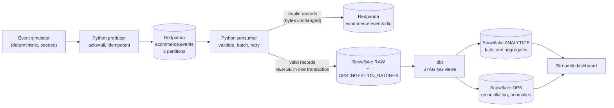
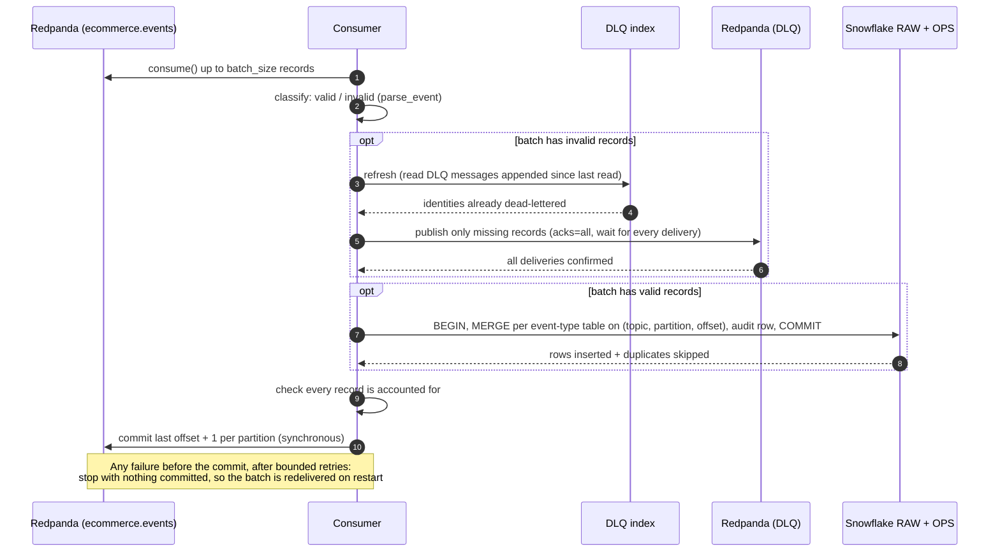

# StreamForge Architecture

## 1. Project Overview

StreamForge is an event-driven e-commerce data engineering platform. It ingests streaming business events through Kafka (Redpanda), validates them, loads them into Snowflake in micro-batches, transforms them with dbt and presents the results in a Streamlit dashboard.

**Objective:** Transform raw e-commerce events into reliable, actionable business intelligence.

**Status:** the MVP pipeline (simulator → producer → Redpanda → consumer → Snowflake RAW → dbt → dashboard) is implemented and tested locally (milestones M0–M8). It runs on a developer machine with a single-node Redpanda broker and an XS Snowflake warehouse; it is not deployed as a production service. Items marked *roadmap* below are not implemented.

## 2. High-Level Architecture

Supporting infrastructure:

| Component | Status |
|---|---|
| Docker Compose (local single-node Redpanda) | Implemented (`infra/docker-compose.yml`) |
| Pytest (unit, Redpanda integration, live Snowflake checks) | Implemented |
| dbt Core (separate virtualenv) | Implemented (`dbt/`) |
| Snowflake Streams and Tasks | Roadmap |
| Apache Airflow (scheduling) | Roadmap |
| AWS S3 (raw event archival) | Roadmap |
| GitHub Actions (continuous integration) | Roadmap |

## 3. Core Components

### 3.1 Event Simulator
Generates simulated e-commerce events, including orders, payments, cancellations, and shipments.

### 3.2 Event Producer
Creates structured events and publishes them to the events topic (`ecommerce.events`), keyed by `order_id` (null key when a record has no usable `order_id`), with `acks=all`, idempotence enabled and delivery confirmed per message by callback. Values are published exactly as generated; validation and dead-letter routing are left to the consumer. Implemented in `streamforge.producer.publisher` (`python -m streamforge.producer`); see `docs/producer.md`.

### 3.3 Redpanda Streaming Layer
Provides Kafka-compatible event streaming, topic management, partitioning, and consumer groups.

### 3.4 Event Consumer
Consumes events, validates schemas, handles retries, and forwards accepted events to Snowflake. Implemented in `streamforge.consumer` (`python -m streamforge.consumer`): batches are validated with `parse_event()`, invalid records go to `ecommerce.events.dlq` unchanged with failure headers, and valid events are loaded into one RAW table per event type in a single transaction via `MERGE` on the Kafka coordinates. Offsets are committed only afterwards. See `docs/consumer.md`.

### 3.5 Snowflake Data Warehouse

Three primary data layers:

- RAW: Original ingested events
- STAGING: Validated and transformed records
- ANALYTICS: Business-ready facts and aggregates

Implemented in M4 as database `ECOMMERCE_STREAMING_DB` (schemas `RAW`, `STAGING`, `ANALYTICS`, plus `OPS` for load audit and reconciliation), the XS warehouse `STREAMFORGE_WH` (60 s auto-suspend) capped by the `STREAMFORGE_MONITOR` resource monitor (5 credits per month), and the least-privilege role `STREAMFORGE_ROLE`. See `docs/snowflake.md`.

### 3.6 Transformation Layer
Uses SQL and dbt for deduplication, incremental transformations, and analytical modelling. Implemented in `dbt/` (dbt Core 1.12, separate `.venv-dbt`): STAGING views deduplicate events by `event_id`; ANALYTICS holds `fct_order_events` and `fct_orders` (incremental merge; order status follows `sequence_number`, not arrival order), `fct_order_items` and the daily per-currency aggregates; OPS views reconcile RAW against the consumer audit and report anomalies. See `docs/dbt.md`.

### 3.7 Dashboard
Uses Streamlit to present order metrics, revenue trends, payment performance, and fulfilment insights. Implemented in `streamforge.dashboard` (`streamlit run src/streamforge/dashboard/app.py`): Executive Overview, Orders, Products, Geography and Pipeline Health tabs read the dbt ANALYTICS and OPS models read-only as STREAMFORGE_ROLE, show money per currency only, and cache query results for 10 minutes. See `docs/dashboard.md`.

### 3.8 Orchestration and Archival (roadmap)
**Not implemented.** Today every step is started by hand: the producer, the consumer (`--stop-when-idle` or until stopped), `dbt/run_dbt.py build` and the dashboard. There is no scheduler and no archive.

Planned, outside the MVP scope:
- **Apache Airflow** to schedule dbt builds and reconciliation checks.
- **AWS S3** to archive raw events beyond Kafka retention.
- **Snowflake Streams and Tasks** as an alternative for incremental processing inside Snowflake.

## 4. Event Processing Lifecycle

1. Generate an e-commerce event.
2. Assign a unique `event_id` and a UTC `event_timestamp`.
3. Publish the event to a Redpanda topic.
4. Consume and validate the event.
5. Record invalid events for investigation.
6. Ingest accepted events into Snowflake RAW.
7. Transform and deduplicate records.
8. Publish analytical datasets.
9. Display business metrics through Streamlit.

### 4.1 Consumer commit protocol

Offsets are committed only after every record in the batch is safely stored: invalid records confirmed in the DLQ, valid records committed in Snowflake. A failure at any step commits nothing, so the batch is redelivered. The RAW `MERGE` makes the redelivery duplicate-free in RAW; the DLQ index skips records already dead-lettered, except in the concurrent-publish and retention cases listed in [`docs/reliability.md`](reliability.md#known-limitations).

Details and the tested failure scenarios: [`docs/consumer.md`](consumer.md) and [`docs/reliability.md`](reliability.md).

## 5. Reliability and Fault Tolerance

- Unique event IDs support deduplication.
- `event_timestamp`, `sequence_number` and `schema_version` support out-of-order reconciliation.
- Retries handle transient processing failures.
- Dead-letter handling isolates invalid or repeatedly failing events.
- Append-only raw storage preserves source events.
- Replay mechanisms support recovery.
- Data quality checks identify missing, duplicate, and inconsistent records.

Delivery is **at-least-once**, made safe by idempotent sinks (RAW `MERGE` on Kafka coordinates, DLQ de-duplication index). It is **not exactly-once end to end**: two consumers can still dead-letter the same record twice if one is evicted from the group while still running (including when it is stuck in retries against a degraded broker), and an expired DLQ entry can be re-created by a replay. Both produce duplicate DLQ entries, not lost records. Guarantees, the 11 failure-injection scenarios and known limitations are in [`docs/reliability.md`](reliability.md).

## 6. Security and Cost Controls

- Credentials are stored in environment variables.
- Secrets are excluded from Git.
- Snowflake warehouses use auto-suspend.
- Small compute resources are preferred during development.
- AWS services are introduced only when required.

## 7. Performance

**No throughput or latency has been measured yet.** The figures below are the original design targets, not results:

| Metric | Design target | Measured |
|---|---:|---|
| Event throughput | 100 events/sec | Not measured |
| Dashboard freshness | Under 10 seconds | Not met by design: the dashboard is as fresh as the last manual dbt build plus a 10-minute query cache |
| Duplicate business records | 0 | RAW: duplicate-free per Kafka message (`MERGE`); STAGING: deduplicated by `event_id`. Verified by tests, not by a load test |
| Event accounting | All accepted events reconciled | Checked per batch before every commit; `OPS.OPS_INGESTION_RECONCILIATION` and dbt tests compare RAW with the audit |
| Recovery | Successful replay after restart | Verified by the Redpanda failure-injection tests (`tests/integration/test_consumer_recovery.py`) |

A local benchmark is planned (M9); until then no throughput figure should be quoted.

## 8. Implementation Status

| Milestone | Scope | Status |
|---|---|---|
| M0 | Packaging and configuration (`streamforge.common.config`) | Done |
| M1 | Event contract and deterministic simulator | Done |
| M2 | Local Redpanda (Docker Compose, topic creation) | Done |
| M3 | Kafka producer | Done |
| M4 | Snowflake database, warehouse, role and resource monitor | Done |
| M5 | Consumer: Kafka → Snowflake RAW + DLQ | Done |
| M6 | dbt transformations (STAGING, ANALYTICS, OPS) | Done |
| M7 | Streamlit dashboard | Done |
| M8 | Reliability: DLQ index, failure-injection tests, `docs/reliability.md` | Done |
| M9 | Production readiness and portfolio: documentation, CI, reproducibility, demo, benchmark | In progress |
| — | Orchestration (Airflow), archival (S3), Snowflake Streams/Tasks | Roadmap |
