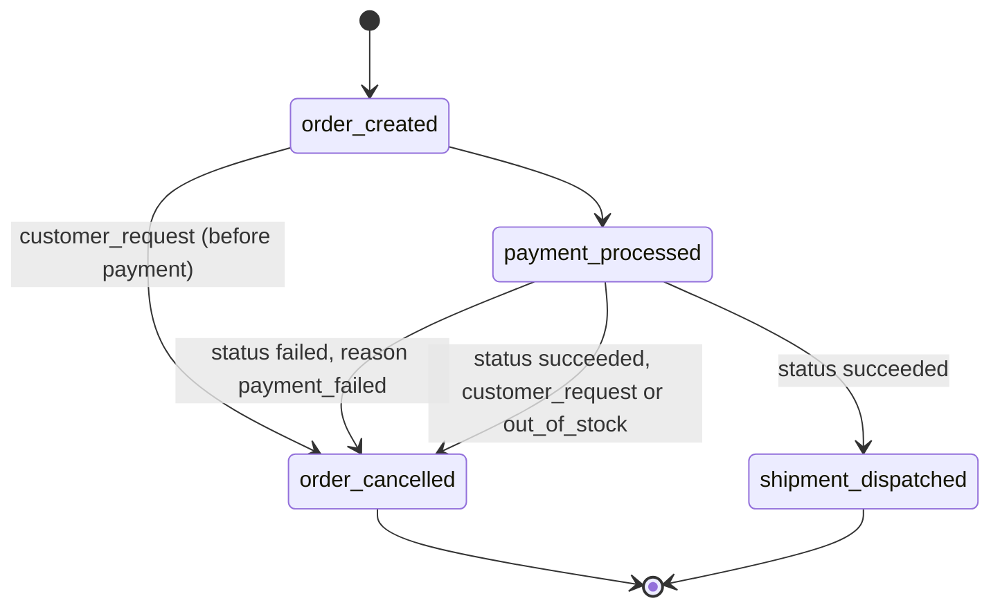

# StreamForge Event Schema

**Contract version:** `schema_version = 1`
**Code:** `src/streamforge/common/events.py` (Pydantic v2 models, `parse_event()`)

This document and the models must stay in sync: `tests/unit/test_event_schema_doc.py` checks that every event type, field and enum value in the code appears here, and that every JSON example below passes `parse_event()`. Change both in the same commit.

## 1. Event envelope

Every event is one JSON object with these top-level fields:

| Field | Type | Rules |
|---|---|---|
| `event_id` | string (UUID v4) | Required. Unique per event. Deduplication key downstream. |
| `event_type` | string enum | Required. One of `order_created`, `payment_processed`, `order_cancelled`, `shipment_dispatched`. Selects the payload schema. |
| `schema_version` | integer | Required. Must be `1`. |
| `event_timestamp` | string (ISO-8601) | Required. When the business event happened. Must include a UTC offset; normalised to UTC and serialized with a `Z` suffix. Naive timestamps are rejected. |
| `order_id` | string | Required. Correlation ID shared by every event of one order. Pattern `ORD-` + 12 uppercase hex characters. |
| `sequence_number` | integer | Required, `>= 1`. Position of the event within its order's lifecycle; contiguous `1..n` per `order_id`. Used to pick the latest order state when events arrive out of order. |
| `source` | string | 1–100 characters. Producing system; the simulator writes `streamforge-simulator`. |
| `payload` | object | Required. Type-specific fields, see section 2. |

No other top-level fields are allowed (unknown fields are rejected).

## 2. Event types and payloads

### 2.1 `order_created`

| Field | Type | Rules |
|---|---|---|
| `customer_id` | string | Pattern `CUST-` + 6 digits. |
| `items` | array of item | At least 1 item. |
| `items[].sku` | string | Pattern `SKU-` + 4 digits. |
| `items[].product_name` | string | 1–200 characters. |
| `items[].quantity` | integer | 1–100. |
| `items[].unit_price` | money | `> 0`. |
| `currency` | string enum | `INR`, `GBP`, `EUR`, `USD`. |
| `order_total` | money | `> 0`. Must equal the sum of `quantity × unit_price` over all items. |
| `shipping_country` | string | Two uppercase letters (ISO 3166-1 alpha-2 format). |

### 2.2 `payment_processed`

| Field | Type | Rules |
|---|---|---|
| `payment_id` | string | Pattern `PAY-` + 12 uppercase hex characters. |
| `amount` | money | `>= 0`. |
| `currency` | string enum | `INR`, `GBP`, `EUR`, `USD`. |
| `method` | string enum | `card`, `paypal`, `bank_transfer`. |
| `status` | string enum | `succeeded`, `failed`. |
| `failure_reason` | string enum or null | `insufficient_funds`, `card_declined`, `fraud_suspected`. Required when `status` is `failed`; must be `null` when `succeeded`. |

### 2.3 `order_cancelled`

| Field | Type | Rules |
|---|---|---|
| `reason` | string enum | `customer_request`, `payment_failed`, `out_of_stock`. |
| `cancelled_by` | string enum | `customer`, `system`. Must be `customer` when `reason` is `customer_request`, otherwise `system`. |

### 2.4 `shipment_dispatched`

| Field | Type | Rules |
|---|---|---|
| `shipment_id` | string | Pattern `SHP-` + 12 uppercase hex characters. |
| `carrier` | string enum | `DHL`, `UPS`, `FedEx`, `Royal Mail`. |
| `tracking_number` | string | 10–20 uppercase letters or digits. |
| `estimated_delivery_date` | string (ISO date, `YYYY-MM-DD`) | Not earlier than the UTC date of `event_timestamp`. |

## 3. Serialization

- UTF-8 JSON, one event per message. The simulator's canonical form is compact (`,` and `:` separators, no spaces), ASCII-only, with keys in model field order, so the same seed, `start_time` and configuration produce byte-identical JSONL.
- **Money** is a JSON *string* with up to 2 decimal places, serialized with exactly 2 (e.g. `"49.98"`), to avoid floating-point loss. More than 2 decimal places is rejected. Snowflake casts with `::NUMBER(12,2)`.
- **Timestamps** are ISO-8601 UTC with a `Z` suffix (e.g. `2026-11-23T10:00:00.204000Z`). The simulator uses millisecond precision.
- Payload fields that are optional are still present, as `null`.

## 4. Order lifecycle

Each order is a chain of correlated events sharing one `order_id`, with `sequence_number` increasing by 1 and `event_timestamp` strictly increasing.



Invariants (enforced by the simulator tests and relied on downstream):

1. The first event of an order is `order_created` with `sequence_number = 1`.
2. At most one terminal event per order: `order_cancelled` or `shipment_dispatched`, never both.
3. `shipment_dispatched` only follows a `payment_processed` with `status = succeeded`.
4. A failed payment is always followed by `order_cancelled` with `reason = payment_failed`.
5. Payment `amount` and `currency` equal the order's `order_total` and `currency`.
6. Within an order, `sequence_number` is contiguous and `event_timestamp` strictly increases.

## 5. Kafka contract (implemented in M3)

| Item | Value |
|---|---|
| Events topic | `ecommerce.events` (env `KAFKA_EVENTS_TOPIC`) |
| Dead-letter topic | `ecommerce.events.dlq` (env `KAFKA_DLQ_TOPIC`) |
| Message key | `order_id`, so all events of one order land in the same partition and stay ordered |
| Message value | The event JSON described above |

Records that fail validation are routed to the dead-letter topic by the consumer (M5) instead of being dropped.

**Fallback key.** A record without a usable `order_id` (for example the `missing_order_id` and `malformed_json` defects) cannot be keyed by order. The producer publishes it with a **null key** rather than failing or inventing a key. Values are published byte-for-byte as generated.

The local broker and topics are described in `docs/redpanda.md`, the producer in `docs/producer.md`.

## 6. Versioning

- `schema_version` identifies the contract. Version `1` is the only accepted version.
- Additive or breaking changes require a new version, an update to this document and the models in the same change, and consumer support before producers emit it.

## 7. Invalid records (testing)

The simulator can inject extra invalid records (`invalid_rate`, default `0`) to exercise consumer validation and dead-letter handling. Invalid generation is separate from valid generation: `src/streamforge/producer/invalid_records.py` works only on raw JSON dicts and strings and never imports pydantic or the event models, so invalid records never go through model construction.

Each invalid record is a raw copy of a valid event's JSON with a fresh `event_id` and exactly one defect:

| Defect | Applies to | Effect |
|---|---|---|
| `missing_event_id` | all types | `event_id` removed |
| `missing_order_id` | all types | `order_id` removed (the record cannot be keyed by order) |
| `unknown_event_type` | all types | `event_type` set to an unsupported value |
| `naive_timestamp` | all types | `event_timestamp` without a UTC offset |
| `malformed_timestamp` | all types | `event_timestamp` not a date-time |
| `unsupported_schema_version` | all types | `schema_version` set to `99` |
| `unexpected_field` | all types | extra top-level field added |
| `malformed_json` | all types | JSON text truncated mid-object, so it is not parseable |
| `negative_amount` | `order_created`, `payment_processed` | `order_total` or `amount` negative |
| `invalid_currency` | `order_created`, `payment_processed` | `currency` set to `XYZ` |
| `empty_items` | `order_created` | `items` empty |
| `total_mismatch` | `order_created` | `order_total` no longer equals the item sum |

Every one is rejected by `parse_event()`. Valid events are never altered, so **records produced = valid events + injected invalid records**.

## 8. Simulator currency

The simulator defaults to `INR` and prices its fixed catalogue in rupees. Other supported currencies (`--currency` / `SimulatorConfig.currency`) use fixed, illustrative conversion factors: not real exchange rates, and only meant to keep simulated prices at a plausible scale.

## 9. Examples

Generated by `python -m streamforge.producer.simulator --orders 2 --seed 42 --start-time 2026-11-23T10:00:00Z`.

`order_created`:

```json
{
  "event_id": "0822e8f3-6c03-4199-972a-846916419f82",
  "schema_version": 1,
  "event_timestamp": "2026-11-23T10:00:00.204000Z",
  "order_id": "ORD-BDD606671AD1",
  "sequence_number": 1,
  "source": "streamforge-simulator",
  "event_type": "order_created",
  "payload": {
    "customer_id": "CUST-000016",
    "items": [
      {"sku": "SKU-1004", "product_name": "27in Monitor", "quantity": 2, "unit_price": "18999.00"},
      {"sku": "SKU-1012", "product_name": "HDMI Cable 2m", "quantity": 1, "unit_price": "449.00"},
      {"sku": "SKU-1003", "product_name": "USB-C Hub", "quantity": 2, "unit_price": "2499.00"}
    ],
    "currency": "INR",
    "order_total": "43445.00",
    "shipping_country": "IN"
  }
}
```

`payment_processed` (failed):

```json
{
  "event_id": "b38a088c-a65e-4389-b74d-0fb132e70629",
  "schema_version": 1,
  "event_timestamp": "2026-11-23T10:00:05.358000Z",
  "order_id": "ORD-BDD606671AD1",
  "sequence_number": 2,
  "source": "streamforge-simulator",
  "event_type": "payment_processed",
  "payload": {
    "payment_id": "PAY-6B658B8148F6",
    "amount": "43445.00",
    "currency": "INR",
    "method": "card",
    "status": "failed",
    "failure_reason": "fraud_suspected"
  }
}
```

`order_cancelled`:

```json
{
  "event_id": "ce4a2bbd-c241-430b-81a9-e71fde8a774b",
  "schema_version": 1,
  "event_timestamp": "2026-11-23T10:01:50.469000Z",
  "order_id": "ORD-BDD606671AD1",
  "sequence_number": 3,
  "source": "streamforge-simulator",
  "event_type": "order_cancelled",
  "payload": {
    "reason": "payment_failed",
    "cancelled_by": "system"
  }
}
```

`shipment_dispatched` (a different order):

```json
{
  "event_id": "3a578a8e-a948-4d99-8bbb-259911ce5dd2",
  "schema_version": 1,
  "event_timestamp": "2026-11-23T10:02:17.609000Z",
  "order_id": "ORD-571A6C307511",
  "sequence_number": 3,
  "source": "streamforge-simulator",
  "event_type": "shipment_dispatched",
  "payload": {
    "shipment_id": "SHP-4A15C5E7CE8A",
    "carrier": "DHL",
    "tracking_number": "3B982EF8DAF61A26",
    "estimated_delivery_date": "2026-11-24"
  }
}
```
